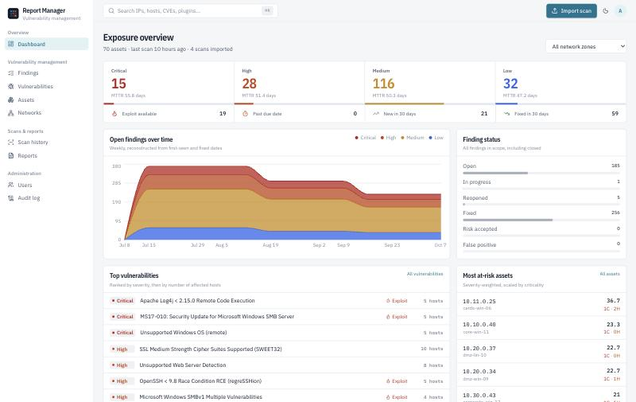
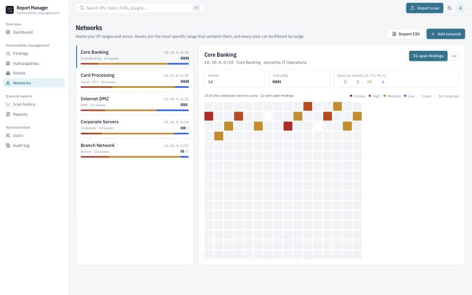
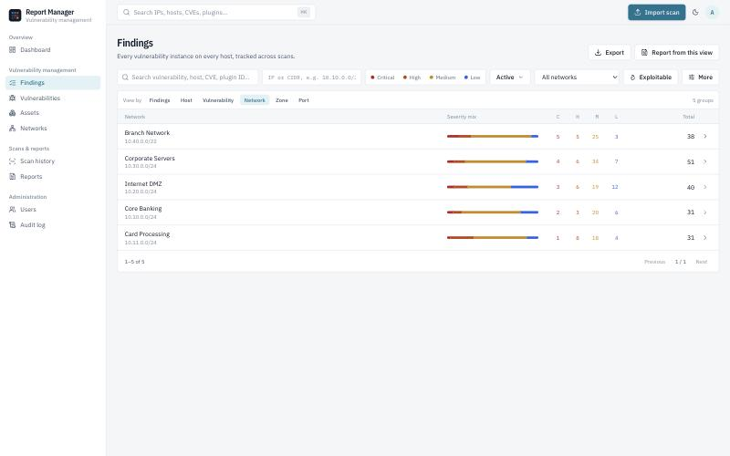
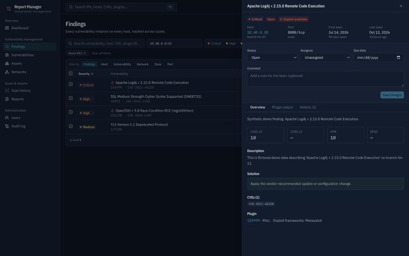

# Report Manager

**Self-hosted vulnerability management for Nessus scan results.** Import `.nessus` exports, track every vulnerability from first detection to verified fix, slice exposure by IP range, zone, severity or asset, and produce branded reports, all inside your own network.

Built for security teams in regulated organisations (banks, payment processors, insurers) that need role-based access, network-scoped visibility, an audit trail, and an air-gapped-friendly deployment.



## Why

Nessus is great at finding vulnerabilities. It is less helpful with the work that comes after:

- *Which findings are new since last month, which were fixed, and which came back?*
- *What is our critical exposure in the Core Banking range versus the DMZ?*
- *Who owns this, when is it due, and why was that one accepted as a risk?*
- *Can the branch IT team see only their own subnets?*
- *Can I hand management a PDF in five minutes?*

Report Manager turns a pile of scan exports into a managed, auditable vulnerability backlog.

## Features

**Scan import & history**
- Drag-and-drop `.nessus` (v2) upload. Several files at once, streamed and parsed in the background, so 100 MB+ files are fine.
- Duplicate file detection (SHA-256), progress tracking, re-import, archive, and delete. Deleting a scan reverts the status changes it caused.
- Each scan shows new, fixed, and persisting findings compared with the previous scan of the same hosts.

**Finding lifecycle that matches reality**
- Each finding is unique per *host + plugin + port + protocol* and tracked across every scan.
- Detected again → `last seen` updates; a `fixed` finding becomes **reopened**.
- Missing from a newer scan of that host → **auto-fixed**, with two safeguards against false closures:
  - an uncredentialed scan never closes findings from a credentialed one;
  - plugin families disabled in the scan policy are never closed.
- Out-of-order imports of older scans are handled correctly.
- Manual statuses: in progress, risk accepted (through approval), false positive. Imports never touch them.

**Explore & manage**
- Findings explorer with shareable URL filters: severity, status, **IP or CIDR**, network, zone, CVE, port, plugin family, CVSS, exploitability, overdue, and scan.
- **View by** host, vulnerability, network, zone, or port, then drill down with one click.
- Bulk assign, status change, due dates, and comments. Every change lands on the finding's timeline.
- Asset inventory with a risk score (severity-weighted, scaled by business criticality), scan timeline, and tags.
- Vulnerability view: where a given CVE or plugin exists across the estate.
- **Software inventory**: every OS, application, package, and service version Nessus found, grouped by product. Search for a product and a version range (for example `log4j` and `<2.17.1`) to list the hosts a new CVE affects, then export them.
- `⌘K` search across IPs, hostnames, CVEs, plugin IDs, and scans.

**Remediation workflow**
- **SLA policies** per severity, with per-zone overrides. Due dates are set automatically, follow policy changes, and show overdue and due-soon badges. Manual dates are kept.
- **Risk acceptance** with justification and expiry, approved by a second admin. The finding reopens automatically when it expires.
- **False positive on all hosts**: one rule suppresses a plugin everywhere, in a range, or on a port, including future imports.
- **My work** for assignees, **@mentions** in comments, and an in-app notification centre.
- **Saved views**, personal or shared, and a **scan compare** page listing new, fixed, and persisting findings between any two scans.
- **Remediation metrics**: SLA compliance, time to fix by severity, zone, and owner team, and weekly detected vs fixed.

**Networks (IP ranges)**
- Name ranges and zones (Core Banking, Cards/PCI, DMZ, Branch…), set criticality and owner, or import them from CSV.
- Assets join the most specific range automatically.
- **Address-space heatmap**: every address in a range coloured by its worst open finding, so you see both risk and scan-coverage gaps.



**Reporting**
- Built-in templates: **Executive Summary**, **Technical Detailed**, **Network / Range Report**.
- Custom templates: choose sections, default scope, intro text, and branding (company name, accent colour, classification banner such as *CONFIDENTIAL*).
- Output as **PDF, Excel (.xlsx), CSV, or HTML**. Any findings view can be turned into a report in one click.

**Access control & audit**
- Local accounts with three roles: **Admin**, **Analyst**, and **Viewer**.
- **Network scoping**: restrict a user to specific ranges. Every query, export, and report respects it.
- Append-only **audit log** covering sign-ins, failed logins, imports, status changes, exports, downloads, and admin actions, with CSV export and a retention setting.

| Findings by network | Finding detail (dark mode) |
|---|---|
|  |  |

## Installation

Report Manager runs as five services: PostgreSQL, Redis, the API, a background worker, and the web UI (nginx). Docker is the easiest way to run them all. You can also run them directly on a host.

### Option A: Docker (recommended)

Requirements: Docker with Compose v2, `make`, and `openssl`.

```bash
git clone https://github.com/itismhn/report-management.git
cd report-management
make docker-env     # writes .env with random RM_SECRET_KEY and POSTGRES_PASSWORD
make docker-up      # builds images, runs migrations, starts everything
make docker-admin   # creates the first admin and prints a temporary password
```

Open <http://localhost:8080> and sign in as `admin`. You will be asked to change the password.

`make docker-env` sets `RM_COOKIE_SECURE=false` so sign-in works over plain `http://`. Once TLS is in front of the app, set it to `true` in `.env` and run `make docker-up` again.

**Want to look around first?** `make docker-demo` loads fictional data: five networks and four monthly scans.

Day-to-day Docker commands:

| Command | What it does |
|---|---|
| `make docker-up` | Build and start, or apply changes after `git pull` / editing `.env` (migrations run automatically) |
| `make docker-down` | Stop the stack. Data volumes are kept |
| `make docker-ps` | Container status and health |
| `make docker-logs` | Follow logs from all containers |
| `make docker-backup` | Dump the database to `backups/` |

Without `make`, use Compose directly. Always pass `--env-file .env`, or Compose cannot resolve `POSTGRES_PASSWORD`:

```bash
docker compose -f deploy/docker-compose.yml --env-file .env up -d --build
docker compose -f deploy/docker-compose.yml --env-file .env exec api python -m app.cli create-admin
```

Data lives in the named volumes `pgdata` (database), `storage` (uploaded scans and generated reports), and `redisdata`. `docker compose down -v` **deletes them**.

### Option B: Without Docker

Requirements: Python 3.12+, [uv](https://docs.astral.sh/uv/), Node 22+, pnpm, PostgreSQL 16+, Redis, and Pango for PDF reports (`brew install pango` on macOS, `apt install libpango-1.0-0 libpangoft2-1.0-0` on Debian/Ubuntu). HTML, Excel, and CSV reports work without Pango.

**Development setup** (hot reload, default settings, no `.env` needed):

```bash
make install     # backend + frontend dependencies
make dev-db      # creates rm_dev and rm_test databases
make migrate
cd backend && .venv/bin/python -m app.cli create-admin && cd ..
make demo        # optional: synthetic data
```

Then, in three terminals:

```bash
make api
```

```bash
make worker
```

```bash
make web
```

The UI runs at <http://localhost:5173> and the API docs at <http://localhost:8000/api/docs>.

**Production on a host:**

1. Create a database and user in PostgreSQL, and make sure Redis is running.
2. Copy `.env.example` to `backend/.env`. Set `RM_SECRET_KEY`, uncomment `RM_DATABASE_URL` and `RM_REDIS_URL`, and point them at your services. Set `RM_STORAGE_DIR` to a directory outside the web root.
3. Install and migrate: `cd backend && uv sync --no-dev && .venv/bin/alembic upgrade head`, then `.venv/bin/python -m app.cli create-admin`.
4. Run the API with `.venv/bin/uvicorn app.main:app --host 127.0.0.1 --port 8000 --proxy-headers`, and run the worker with the command from `make worker`. Use systemd or a similar tool to keep both running. Run **one** worker only, because it also runs the scheduler.
5. Build the UI with `cd frontend && pnpm install && pnpm build`, and serve `frontend/dist` with nginx. Use [frontend/nginx.conf](frontend/nginx.conf) as the template, changing `proxy_pass http://api:8000` to `http://127.0.0.1:8000`.

## Usage

1. **Add networks** (*Networks*): name your IP ranges and zones, set criticality and owner, or import them from CSV. Assets are matched to the most specific range.
2. **Import scans** (**Import scan** in the top bar): in Nessus, export a scan as **.nessus**, then drag one or more files in. Parsing runs in the background. *Scan history* shows progress and, per scan, the new, fixed, and persisting findings.
3. **Work the findings** (*Findings*, *Vulnerabilities*, *Assets*, *Software*): filter by severity, network, status, or CVE. Assign owners, set due dates, comment, accept risks, or mark false positives. Assignees see their queue under *My work*; risk acceptances wait in *Risk approvals*.
   To check a new CVE against your estate, open *Software*, search for the product, and enter the affected range in the version box, e.g. `<2.17.1` or `>=19.3 <19.21`. *By host* lists every matching host with the port or path where the software was found. Credentialed scans give the most complete inventory, because uncredentialed scans only see what network services announce.
4. **Report** (*Reports*): pick a template, scope, and format (PDF, XLSX, CSV, HTML).
5. **Administer** (*Users*, *Settings*, *Audit log*): create users with the Admin, Analyst, or Viewer role and restrict them to networks, set SLA policies and branding, and review the audit log.

Press `⌘K` / `Ctrl+K` anywhere to search IPs, hostnames, CVEs, plugins, and scans.

## Help

### Make commands

Run `make help` to list every target. The main ones are `install`, `migrate`, `api`, `worker`, `web`, `demo`, `test`, `lint`, `typecheck`, and the `docker-*` targets above.

### Admin CLI

Run these inside `backend/` with `.venv/bin/python -m app.cli …`, or in Docker with `make docker-admin` / `docker compose … exec api python -m app.cli …`:

| Command | What it does |
|---|---|
| `create-admin [--username admin] [--email …] [--password …]` | Create an admin. A random temporary password is printed if you omit one |
| `seed-demo [--months 4] [--hosts-per-network 12]` | Load demo networks and synthetic scans into the database |
| `demo-files [--out demo-data]` | Write synthetic `.nessus` files to try the upload flow |
| `rebuild-software [--if-empty]` | Rebuild the software inventory from findings already in the database |
| `--help` | Show all commands and options |

### Configuration

All settings are environment variables with the `RM_` prefix. See [.env.example](.env.example) for the full list. The ones you will most likely change:

| Variable | Default | Notes |
|---|---|---|
| `RM_SECRET_KEY` | (none) | **Required** in production, at least 32 characters. Signs session tokens |
| `RM_ENVIRONMENT` | `development` | `production` disables API docs and enforces the secret check |
| `RM_COOKIE_SECURE` | `false` | Set to `true` when served over HTTPS |
| `RM_DATABASE_URL` / `RM_REDIS_URL` | localhost | Built automatically in Docker |
| `RM_MAX_UPLOAD_MB` | `1024` | Keep `client_max_body_size` in nginx.conf in sync |
| `HTTP_PORT` | `8080` | Docker only: host port for the UI |

### Troubleshooting

- **Sign-in succeeds but you land back on the login page:** you are on plain `http://` with `RM_COOKIE_SECURE=true`. Set it to `false`, or put HTTPS in front.
- **`api` keeps restarting with "Set RM_SECRET_KEY…":** the key is missing, still `change-me`, or shorter than 32 characters.
- **`required variable POSTGRES_PASSWORD is missing`:** you ran `docker compose` without `--env-file .env`. Use the `make docker-*` targets.
- **API cannot connect to the database after changing `POSTGRES_PASSWORD`:** the database volume keeps the original password. Change it back, or update the password inside PostgreSQL.
- **Upload stuck in "queued":** the worker is not running. Check `make docker-logs` (Docker) or the `make worker` terminal.
- **PDF reports fail outside Docker:** install Pango (see requirements above).
- **Port 8080 already in use:** set `HTTP_PORT` in `.env` and run `make docker-up` again.

## Architecture

```
            ┌──────────────┐     ┌───────────────────┐
 browser ──▶│ nginx (SPA)  │────▶│ FastAPI  /api/v1  │──┐
            └──────────────┘     └───────────────────┘  │   ┌────────────┐
                                          │ enqueue      ├──▶│ PostgreSQL │
                                          ▼              │   └────────────┘
                                   ┌─────────────┐       │
                                   │ Redis queue │──▶ Celery worker ──┘
                                   └─────────────┘   (parse .nessus, render reports)
```

| Layer | Technology |
|---|---|
| API | Python 3.13, FastAPI, SQLAlchemy 2, Alembic, Pydantic v2 |
| Database | PostgreSQL: native `inet`/`cidr` types with GiST indexes for fast range queries |
| Jobs | Celery + Redis |
| Parsing | lxml streaming `iterparse` with entity resolution and network access disabled (XXE-safe) |
| Reports | Jinja2 → WeasyPrint (PDF), openpyxl (XLSX) |
| UI | React 19, TypeScript, Vite, TanStack Router & Query, Tailwind CSS v4, Radix UI, Recharts |

See [docs/architecture.md](docs/architecture.md) for the data model and lifecycle rules.

## Security

- Passwords are hashed with Argon2id. Accounts lock after repeated failures, and admin-issued passwords must be changed at first login.
- Sessions use httpOnly, SameSite=strict cookies: a short-lived access token and a rotating refresh token with reuse detection. CSRF uses a double-submit token.
- Row-level network scoping is applied in a single query helper and covered by tests.
- Uploads are size-limited, content-checked, and stored outside the web root. The XML parser cannot fetch external entities.
- Spreadsheet exports are protected against formula injection.
- nginx sends a strict Content-Security-Policy and rate-limits login.
- No external CDNs or telemetry: fonts and assets are bundled, so it works in air-gapped networks.

Found a vulnerability? Please follow [SECURITY.md](SECURITY.md).

> **Never commit real scan files.** They reveal internal addresses and weaknesses. Use the synthetic generator: `python -m app.cli demo-files`.

## Roadmap

Planned work, including KEV/EPSS enrichment, a report template builder, scheduled reports, Tenable API sync, Jira/ServiceNow, and LDAP/SSO, is tracked in [ROADMAP.md](ROADMAP.md).

## Contributing

Contributions are welcome. Read [CONTRIBUTING.md](CONTRIBUTING.md) to get started.

## License

[Apache License 2.0](LICENSE)

*Nessus is a registered trademark of Tenable, Inc. This project is independent and not affiliated with or endorsed by Tenable.*
